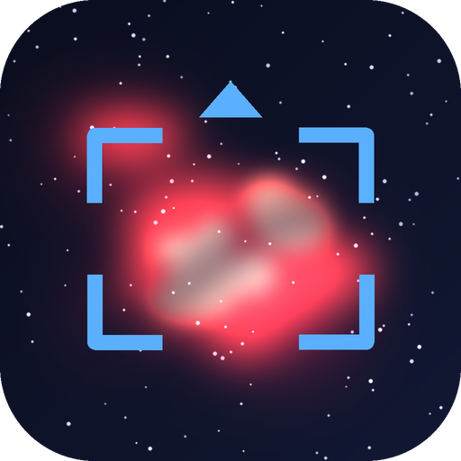

<p align="center">
  
</p>

<h1 align="center">APU Prospector</h1>

暗星雲構圖與探勘工具。很多構圖軟體用 DSS 光學巡天當底圖，暗的 Sh2、LBN、IFN 根本看不到；
APU Prospector 改用 Hα 與紅外塵埃的全天巡天圖當底，把這些目標直接畫出來，
再依你的觀測地點和地平線遮蔽，算出今晚能拍幾小時。

## 特色

- **看得見暗星雲的底圖**：DSS2 / Mellinger / Pan-STARRS 底圖上疊 Hα（Finkbeiner 全天、VTSS、IPHAS）
  與塵埃（IRIS 100µm、Planck 857 GHz、SFD 消光），各層可調透明度、拉伸、上下限。
  三個預設組合：Hα 發射星雲、IFN／塵埃、純光學
- **目錄**：Sharpless、LBN、LDN、Barnard、vdB、Cederblad、RCW、WISE HII 區、行星狀星雲（≥20″），
  共 11,047 個，照實際大小畫圈，每個目標附上範圍內的平均 Hα（Rayleigh）與 100µm 塵埃量
- **雙鏡筒構圖**：兩支鏡筒的框同時顯示，焦距、相機、位置角、馬賽克都可自訂，內建常見 ZWO／QHY 相機尺寸
- **讀值**：滑鼠移到哪就顯示該點的 Hα／塵埃數值；「框內訊號」列出構圖框內的平均、中位、P90、最高值
- **今晚可見度**：天文暗夜、月照、距滿月天數、構圖中心的仰角曲線與可拍時段
- **觀測地點與地平線遮蔽**：經緯度、時區、滿月規則都能改，也可以用目前位置；
  遮蔽可以依方位分段設定最低仰角
- **探勘**：從勾選的目錄中，找今晚可拍時數夠、大小適合鏡筒的目標，可依時數、Hα 亮度、塵埃量或大小排序
- **匯出 NINA**：每支鏡筒各自匯出 CSV（含馬賽克每一格），在 NINA 簡易序列按「匯入目標」選這個檔案
- 介面為繁體中文

## 下載

到 [Releases 頁面](../../releases/latest) 下載對應的檔案，不用另外安裝 Python：

| 系統 | 檔案 |
|---|---|
| Windows 10 / 11（64 位元） | `APUProspector-版本-win64.exe` |
| Mac（Apple M 系列晶片） | `APUProspector-版本-macos-arm64.zip` |
| Mac（Intel 處理器） | `APUProspector-版本-macos-x86_64.zip` |

程式會開一個小視窗並自動打開瀏覽器，在瀏覽器裡使用；關掉小視窗就結束。
需要網路（天圖和資料即時向 CDS 讀取），瀏覽器要支援 WebGL2（近年的 Chrome、Edge、Firefox、Safari 都可以）。

### Windows

下載的 `APUProspector-版本-win64.exe` 就是程式本身，不用安裝也不用解壓縮，雙擊就能開（可以放在桌面或任何資料夾）。
每次開啟要先把程式解開到暫存資料夾，約 2–5 秒後才出現視窗，等待時不用重複雙擊。

> 第一次開啟時，Windows 可能會跳出「Windows 已保護您的電腦」。這是因為程式沒有購買數位簽章，
> 按「**其他資訊**」→「**仍要執行**」即可。下載時瀏覽器若提示「不常下載的檔案」，選「保留」。
> 少數防毒軟體會對這類打包成單一檔案的程式誤報，可以把它加到例外清單。

### Mac

1. 雙擊下載的 zip 解壓縮，把 `APUProspector.app` 拖到「應用程式」資料夾
2. 雙擊 APUProspector。第一次會跳出「Apple無法驗證『APUProspector』是否為惡意軟體…」，按「**完成**」
   （不要按「丟到垃圾桶」）。這是因為程式沒有購買 Apple 的付費簽章，不是程式有問題
3. 點左上角蘋果選單 →「**系統設定**」→ 左邊的「**隱私權與安全性**」
4. 右邊往下捲到「**安全性**」，會看到「已阻擋『APUProspector』以保護你的Mac。」，按旁邊的「**強制打開**」
5. 接著會要你輸入 Mac 的登入密碼（或按 Touch ID），再跳出詢問時一樣按「**強制打開**」

只有第一次要這樣做，之後雙擊就能直接開。

不知道自己的 Mac 是哪一種？點左上角蘋果選單 →「關於這台 Mac」，晶片寫 Apple M1、M2… 就是 M 系列，寫 Intel 就是 Intel。

> Windows 版已實際測試；兩個 Mac 版是雲端自動打包並通過自我測試，還沒在實體 Mac 上操作過，遇到問題請告訴我。

## 使用方式

1. **先設定地點**：左邊「今晚可見度」→「觀測地點設定」，填經緯度（北、東為正）和時區，或按「使用目前位置」。
   「地平線遮蔽設定」可以依方位分段設定最低仰角（起點大於終點表示跨過正北，例如 315°→45°）。
   預設是嘉義六腳（鄉鎮精度）
2. **設定鏡筒**：「構圖」裡填焦距、選相機（或自訂感光元件尺寸），可以只開一支
3. **找目標**：上方搜尋 `Sh2-129`、`LDN 1235`、`NGC 7000`、座標都可以；或在「探勘」按「開始探勘」，點清單裡的目標
4. **構圖**：拖動天圖，構圖框跟著畫面中心走；調位置角、馬賽克，看「框內訊號」和今晚可拍時段
5. **匯出**：按「匯出 NINA CSV」，在 NINA 的簡易序列（Simple Sequencer）按「匯入目標」選這個檔案

設定（地點、鏡筒、圖層）存在瀏覽器裡，下次打開會記得。

## 注意事項

- 位置角（PA）定義為影像「上方」由北往東量，對應 NINA 的 Position Angle。第一次使用請拍一張做 plate solve，確認方向一致
- 座標一律 J2000；可見度用低精度公式（約 0.1°），未做歲差修正，規劃用足夠
- Hα 與塵埃圖解析度約 2–6′，用來判斷「這裡有沒有東西、大概多亮」，細節要看自己拍的
- IFN 是寬頻反射光、非常暗，在光害地區（Bortle 5 以上）很難拍，「IFN／塵埃」模式比較適合規劃暗空行程
- 程式只聽本機（127.0.0.1:8765），被占用時會改用 8766、8767…；換了連接埠，瀏覽器裡的設定是分開存的

## 從原始碼執行

需要 Python 3.10 以上，只用標準函式庫：

```
python serve.py            開小視窗並打開瀏覽器
python serve.py --console  不開視窗，在主控台執行
```

Windows 也可以雙擊 `start.cmd`。

### 重建目錄

```
pip install numpy
python tools/build_catalogs.py
```

從 VizieR 下載目錄、從 hips2fits 下載全天 Hα 與 100µm 圖，計算每個目標範圍內的平均值，寫入 `data/catalogs.json`。
下載結果快取在 `tools/.cache/`。

### 打包

```
pip install pyinstaller pillow
python packaging/build_exe.py
```

Windows 可以直接雙擊 `build_exe.cmd`（會建一個獨立的虛擬環境），產生單一執行檔 `dist/APUProspector-版本-win64.exe`。
打包完會自動執行一次打包好的程式做自我測試。
Mac 版由 GitHub Actions 的雲端 Mac 在發布 Release 時自動打包。

## 資料來源與致謝

- 天圖引擎：[Aladin Lite v3](https://aladin.cds.unistra.fr/AladinLite/)（CDS, Strasbourg）
- 巡天影像（CDS HiPS）：DSS2、Finkbeiner (2003) 全天 Hα、VTSS、SHASSA、IPHAS DR2、IRIS（Miville-Deschênes & Lagache 2005）、
  Planck HFI、Schlegel, Finkbeiner & Davis (1998)
- 讀值：CDS [hips2fits](https://alasky.cds.unistra.fr/hips-image-services/hips2fits)
- 目錄：[VizieR](https://vizier.cds.unistra.fr/)（CDS）—— VII/20 Sharpless、VII/9 LBN、VII/7A LDN、VII/220A Barnard、
  VII/21 vdB、VII/231 Cederblad、VII/216 RCW、J/ApJS/212/1 WISE HII（Anderson et al. 2014）、V/84 Strasbourg-ESO PN
- 名稱解析：CDS Sesame

This research has made use of the VizieR catalogue access tool, the Aladin sky atlas and the hips2fits service, CDS, Strasbourg, France.

## 授權

本專案程式碼採用 [MIT License](LICENSE)。

Aladin Lite（GPL-3.0）在執行時由 jsDelivr 載入，沒有包含在本專案或打包好的程式裡。
目錄資料來自 VizieR，使用時請依各目錄原始文獻引用。
